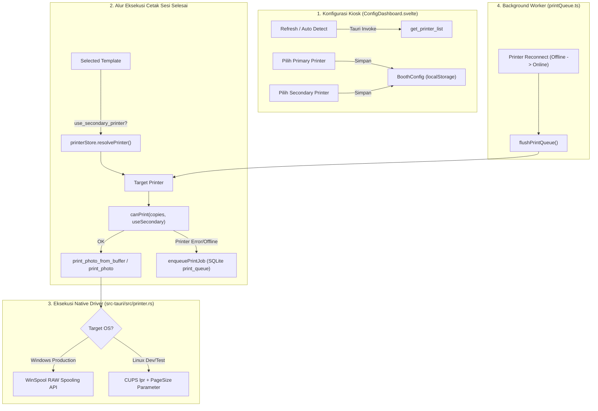

# Dokumentasi Integrasi Printer & Fitur Print Secondary (Sprint 3)

**Modul:** Photobooth Desktop Client (`potohub-dekstop-app`) & Ekosistem PotoHub  
**Target Platform:** Windows (Production Kiosk) & Linux (Testing & Development)  
**Versi Dokumen:** 1.0.0  
**Tanggal:** 2026-10-03  
**Status:** ✅ **SELESAI & TERVERIFIKASI PENUH**

---

## 1. Ikhtisar & Tujuan Sprint

Sprint 3 berfokus pada penyelesaian integrasi perangkat keras printer foto dye-sublimation (**DNP DS-RX1 / DS-RX1HS**), penghapusan fungsionalitas tiruan/hardcode (*zero-mock policy*), arsitektur cetak **OS-Aware** (Windows native WinSpool & Linux CUPS), standardisasi ukuran kertas cetak sesuai `paper-sizes.json`, serta implementasi fitur **"Print Secondary"** untuk fleksibilitas pemotongan/format kertas.

### Sasaran Utama:
1. **Deteksi Hardware Riil & Zero Mock**: Menghilangkan mock virtual printer. Jika kabel USB printer dicabut, sistem secara instan mendeteksi status `OFFLINE` dan mengosongkan daftar perangkat.
2. **Arsitektur OS-Aware**:
   - Mesin booth produksi menggunakan sistem operasi **Windows** (memanfaatkan WinSpool API).
   - Mesin pengujian dan development menggunakan **Linux** (memanfaatkan CUPS & Gutenprint driver).
3. **Fitur "Print Secondary"**: Memungkinkan alih cetak layout template dari *Primary Printer* ke *Secondary Printer* (misal: Primary disiapkan untuk strip potong 2x6, Secondary untuk foto utuh 4x6).
4. **Standardisasi Ukuran Kertas**: Mendukung seluruh varian ukuran kertas standar pada `paper-sizes.json` dengan safe database migration.
5. **Peningkatan UX Dasbor**: Proteksi anti-spam klik saat offline (beralih ke format teks seperti deteksi kamera) dan tombol refresh interaktif dengan animasi loading spinner.

---

## 2. Rincian Sub-Langkah Integrasi Printer



---

### Sub-Langkah 2.1: Verifikasi Hardware & Pengujian Fisik Terminal (DNP DS-RX1)

Sebelum pengkodean programatik, dilakukan diagnosa dan verifikasi perangkat keras langsung pada mesin DNP:
1. **Status Indikator LED Hardware DNP DS-RX1**:
   - LED **Ribbon** dan **Paper** dalam kondisi mati menandakan pita ribbon dan kertas gulung terpasang dengan baik (normal).
   - LED **Power** menyala hijau solid menandakan unit siap beroperasi (*Ready*).
2. **Koneksi CUPS & Driver Gutenprint**:
   - Perangkat terdeteksi pada URI `direct gutenprint53+usb://dnp-dsrx1/Cy2C63549159`.
3. **Uji Cetak Terminal**:
   - Berhasil mencetak foto fisik melalui perintah:
     ```bash
     lpr -P DNP_DSRX1 -o PageSize=w288h432 ~/Downloads/test.jpg
     ```
   - **Catatan Teknis**: Printer dye-sub DNP memerlukan opsi `PageSize` eksplisit (misal `w288h432` untuk ukuran 4x6 / 4R) agar spooler tidak menolak format buffer gambar.

---

### Sub-Langkah 2.2: Backend Rust OS-Aware (`src-tauri/src/printer.rs` & `src-tauri/src/lib.rs`)

Backend Tauri dibuat fleksibel dan peka terhadap sistem operasi target (*OS-Aware*):
1. **Implementasi Windows Production (`#[cfg(target_os = "windows")]`)**:
   - Menggunakan WinAPI `winspool` (`EnumPrintersW`, `OpenPrinterW`, `StartDocPrinterW`, `StartPagePrinter`, `WritePrinter`, `EndPagePrinter`, `EndDocPrinter`, `ClosePrinter`).
   - Mengirimkan buffer gambar mentah (RAW) langsung ke driver printer DNP tanpa dialog print Windows.
2. **Implementasi Linux Development/Testing (`#[cfg(not(target_os = "windows"))]`)**:
   - **Deteksi Dua Tahap**: Membaca antrean CUPS (`lpstat -e`), dan jika belum terkonfigurasi, otomatis mengekstrak printer USB langsung dari `lpinfo -v`.
   - **Deteksi Cabut Kabel (Unplug)**: Ketika kabel USB dicabut, perangkat langsung hilang dari output `lpinfo -v` / `lpstat`, mengembalikan array kosong dan status `OFFLINE`.
   - **Pemetaan Ukuran Kertas Otomatis (`map_paper_size_to_cups`)**:
     - `4R` / `4x6`: `-o PageSize=w288h432`
     - `2R` / `2x6`: `-o PageSize=w288h432 -o DNP2x6Cut=True` (pemotongan ganda otomatis strip 2x6)
     - `6R` / `6x8`: `-o PageSize=w288h576`
     - `6x6`: `-o PageSize=w288h288`
     - `A4`: `-o PageSize=A4`
3. **Database SQLite Lokal Migration 11 (`src-tauri/src/lib.rs`)**:
   - Menambahkan kolom `use_secondary` pada tabel `print_queue`:
     ```sql
     ALTER TABLE print_queue ADD COLUMN use_secondary INTEGER NOT NULL DEFAULT 0;
     ```
4. **Unit Test Backend**:
   - `test_print_options_default`: Verifikasi default copies = 1 dan paper size = `4x6`.
   - `test_printer_status_empty_name`: Memastikan penanganan input printer kosong aman.
   - `test_cups_paper_size_mapping`: Memvalidasi mapping nama ukuran ke format parameter CUPS.
   - `test_print_empty_buffer_fails`: Memvalidasi penolakan buffer kosong.
   - *Hasil uji:* `cargo test --lib printer` -> **4 passed; 0 failed**.

---

### Sub-Langkah 2.3: Safe Migration & Model Backend API (`api/`)

Pembaruan pada backend cloud API agar mengenali ukuran kertas baru dan atribut printer sekunder:
1. **Safe SQL Migration (`api/migrations/20261003000000_extend_paper_sizes_and_secondary_printer.sql`)**:
   - Memperluas enum `paper_size` tanpa menghapus tabel:
     ```sql
     ALTER TYPE paper_size ADD VALUE IF NOT EXISTS '2R';
     ALTER TYPE paper_size ADD VALUE IF NOT EXISTS '3R';
     ALTER TYPE paper_size ADD VALUE IF NOT EXISTS '5R';
     ALTER TYPE paper_size ADD VALUE IF NOT EXISTS '6R';
     ALTER TYPE paper_size ADD VALUE IF NOT EXISTS '8R';
     ALTER TYPE paper_size ADD VALUE IF NOT EXISTS '10R';
     ALTER TYPE paper_size ADD VALUE IF NOT EXISTS 'A7';
     ALTER TYPE paper_size ADD VALUE IF NOT EXISTS 'A6';
     ALTER TYPE paper_size ADD VALUE IF NOT EXISTS 'A5';
     ALTER TYPE paper_size ADD VALUE IF NOT EXISTS 'A4';
     ALTER TYPE paper_size ADD VALUE IF NOT EXISTS 'A3';
     ALTER TABLE templates ADD COLUMN IF NOT EXISTS use_secondary_printer BOOLEAN NOT NULL DEFAULT FALSE;
     ```
   - Template yang telah ada (format `4R`) tetap valid dan aman 100%.
2. **Model & Handler Template Rust (`api/src/models/template.rs`, `api/src/handlers/template.rs`)**:
   - Menambahkan varian enum `PaperSize` dan field `use_secondary_printer` pada struct `Template`, `CreateTemplateRequest`, dan `UpdateTemplateRequest`.
3. **Integration Test Suite (`api/tests/template_printer_test.rs`)**:
   - Menguji serialisasi enum kertas, backward-compatibility payload lama, flag secondary printer, dan simulasi resolusi target printer OS-aware.
   - *Hasil uji:* `cargo test --test template_printer_test` -> **4 passed; 0 failed**.

---

### Sub-Langkah 2.4: Store Reaktif Svelte 5 & Antrean Cetak Offline (`dekstop-app/src/lib/`)

1. **`printerStore` (`src/lib/printer.svelte.ts`)**:
   - Mengelola status terpisah untuk printer utama (`selectedPrinter`, `status`) dan printer kedua (`secondaryPrinter`, `secondaryStatus`).
   - Metode `resolvePrinter(useSecondary?: boolean)`:
     ```typescript
     resolvePrinter(useSecondary?: boolean): string | null {
       if (useSecondary && this.secondaryPrinter) {
         return this.secondaryPrinter;
       }
       return this.selectedPrinter;
     }
     ```
   - Metode `canPrint(copies, useSecondary)`: Mengecek status ketersediaan, status error, dan kecukupan kertas pada printer tujuan.
   - Pemicu otomatis `flushPrintQueue()` saat printer mengalami transisi status dari `OFFLINE` menjadi `ONLINE`.
2. **Konfigurasi Booth (`src/lib/stores/boothConfig.svelte.ts`)**:
   - Menambahkan atribut `primaryPrinter: string` dan `secondaryPrinter: string` pada `BoothCfg` yang tersimpan otomatis di `localStorage`.
3. **Manajemen Antrean Cetak Lokal (`src/lib/db/local.ts` & `src/lib/utils/printQueue.ts`)**:
   - `enqueuePrintJob`: Menyimpan flag `use_secondary` ke tabel `print_queue`.
   - `flushPrintQueue`: Mengecek kesiapan printer spesifik target (`useSecondary`) sebelum memanggil print, memastikan job tidak tertukar antar printer.
4. **Alur Otomatis Cetak Sesi Selesai (`V1Complete.svelte`, `V2Download.svelte`, `V3Download.svelte`)**:
   - Menyerahkan parameter `useSecondary = Boolean(selectedTemplate?.use_secondary_printer)` saat memanggil fungsi cetak langsung maupun saat memasukkan ke antrean fallback.

---

### Sub-Langkah 2.5: Antarmuka Dasbor Konfigurasi Kiosk (`ConfigDashboard.svelte`)

Peningkatan UX pada halaman pengaturan booth:
1. **Dropdown Primary Printer**:
   - Menampilkan seluruh printer terdeteksi dengan status langsung, misal: `DNP_DSRX1 (Ready)` atau `DNP_DSRX1 (Offline)`.
2. **Dropdown Secondary Printer**:
   - Memungkinkan memilih printer kedua untuk tugas khusus, atau memilih `-- Nonaktif (Gunakan Primary) --`.
3. **Proteksi Anti-Spam Klik**:
   - Jika tidak ada printer USB yang tersambung, elemen `<select>` ditiadakan dan diganti dengan teks informatif:
     `"Tidak ada printer terdeteksi."` / `"Mencari printer via USB…"` (konsisten dengan desain deteksi kamera DSLR).
4. **Tombol Refresh Interaktif**:
   - Menggunakan ikon `RotateCw` dengan animasi putar `animate-spin` dan label teks `"Mendeteksi..."` selama pemindaian port USB berlangsung.

---

### Sub-Langkah 2.6: Editor Template Frame Admin Dashboard (`TemplateFramePage.svelte`)

Pembaruan pada antarmuka admin pengelola template:
1. **Pilihan Ukuran Kertas Lengkap Sesuai `paper-sizes.json`**:
   - Menyediakan pilihan nama bersih langsung tanpa teks dimensi/embel-embel tambahan (misal: `4R`, `2R`, `3R`, `5R`, `6R`, `8R`, `10R`, `A7`, `A6`, `A5`, `A4`, `A3`, `6x8`, `2x6`, `6x6`, `Custom`).
   - Otomatis mengisi lebar (*width*) dan tinggi (*height*) canvas template saat ukuran kertas dipilih.
2. **Toggle "Print Secondary"**:
   - Tombol toggle mini pada bilah konfigurasi template terikat ke state `printSecondaryGlobal`.
   - Nilai tersimpan ke database melalui atribut `use_secondary_printer` pada payload API.

---

## 3. Matriks Hasil Verifikasi & Validasi Pengujian

| Komponen | Lingkungan | Jenis Pengujian | Hasil | Catatan |
| :--- | :--- | :--- | :--- | :--- |
| **DNP DS-RX1** | Linux CUPS | Fisik via Terminal | **SUKSES** | Cetak fisik keluar dengan opsi `-o PageSize=w288h432` |
| **`printer.rs`** | Desktop App (Rust) | `cargo test --lib printer` | **4/4 PASSED** | Default options, empty name, cups mapping, empty buffer |
| **`template_printer_test.rs`** | Backend API (Rust) | `cargo test --test template_printer_test` | **4/4 PASSED** | Enums, backward compat, secondary flag, OS resolution |
| **Desktop App Svelte** | Desktop App (TS/Svelte) | `pnpm check` | **0 Errors, 0 Warnings** | Validasi tipe data dan Svelte 5 runes |
| **Admin Dashboard** | Web Dashboard | `pnpm build` | **0 Errors** | Bundle production berhasil dibuild |
| **Cabut/Colok USB** | Hardware Riil | Live Detection | **SUKSES** | Status langsung berganti antara Ready dan Tidak Terdeteksi |

---

## 4. Panduan Operasional untuk Operator Booth

1. **Pengaturan Printer Default (Single Printer)**:
   - Hubungkan printer DNP via USB.
   - Buka dasbor konfigurasi (`/settings` atau via PIN).
   - Pastikan **Primary Printer** terpilih nama printer DNP dengan label `(Ready)`.
   - Biarkan **Secondary Printer** pada posisi `-- Nonaktif (Gunakan Primary) --`.
2. **Pengaturan Dual-Printer (Primary Strip Cut 2x6 + Secondary Full 4x6)**:
   - Hubungkan kedua printer ke port USB kiosk.
   - Pada Dasbor Konfigurasi:
     - Pilih Printer 1 sebagai **Primary Printer** (dikonfigurasi dengan mode potong split 2x6 pada driver).
     - Pilih Printer 2 sebagai **Secondary Printer** (dikonfigurasi mode cetak utuh 4x6).
   - Pada Admin Dashboard:
     - Untuk template foto strip 2x6, biarkan opsi *Print Secondary* dalam posisi **Off**.
     - Untuk template foto penuh 4x6, aktifkan opsi *Print Secondary* ke posisi **On**.
     - Sistem kiosk akan secara otomatis mengarahkan cetakan ke printer yang tepat tanpa memerlukan intervensi operator saat sesi berlangsung.
