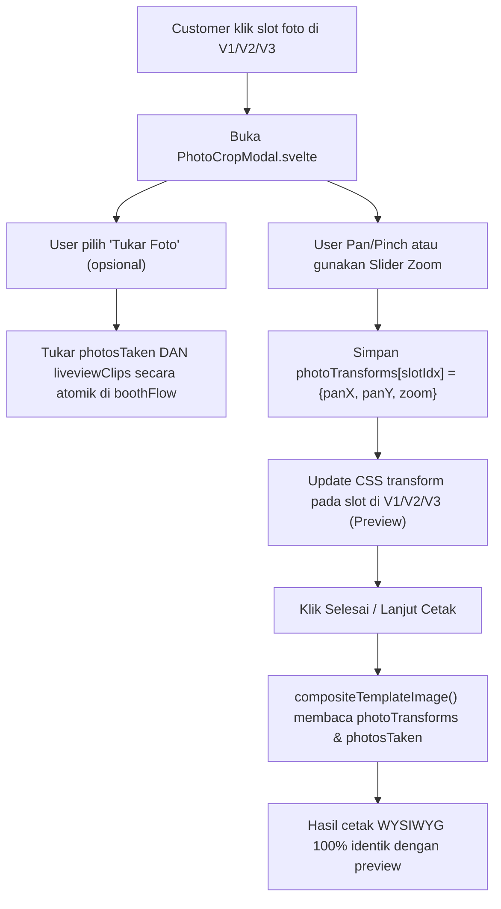

# Rencana Implementasi: Fitur Pan-Pinch (Crop/Zoom) & Tukar Posisi Foto per Slot

**Dokumen Panduan Teknis & Instruksi Kerja untuk Developer**  
**Target Repository:** `dekstop-app` (Tauri v2 + SvelteKit 2 + Svelte 5 Runes)  
**Komponen Utama:** 
- `src/lib/components/v1/V1Customize.svelte`
- `src/lib/components/v2/V2Filter.svelte`
- `src/lib/components/v3/V3Filter.svelte`
- `src/lib/utils/templateComposite.ts`
- `src/lib/stores/booth.svelte.ts`
- `src/lib/utils/sessionAssets.ts`

---

## 1. Ringkasan Kebutuhan & Tujuan Fitur

Aplikasi photobooth saat ini menampilkan foto jepretan kamera (`boothFlow.photosTaken`) yang dipasang secara otomatis ke slot template menggunakan CSS `object-fit: cover` (terpusat). Namun pada praktiknya, sering kali:
1. **Framing Terpotong:** Posisi kepala atau pose customer terpotong tepi bingkai, sehingga customer memerlukan kemampuan untuk menggeser posisi foto (**Pan/Drag**) dan memperbesar/memperkecil (**Pinch-to-zoom / Scale**).
2. **Keinginan Menukar Posisi Jepretan:** Customer ingin memindahkan hasil foto tertentu ke slot lain (misalnya foto ke-3 ingin dipindah ke slot atas/pertama).

Dokumen ini memuat **pertimbangan arsitektur, titik rawan bug (collision), serta panduan implementasi step-by-step** agar developer dapat mengeksekusi fitur ini dengan performa 60 FPS di perangkat mini-PC kiosk tanpa merusak aset lain seperti **Liveview Video Composite** dan **GIF Sesi**.

---

## 2. Peringatan Penting: Titik Rawan Bug & Tabrakan Fungsi (Collisions)

Sebelum menulis kode, developer **WAJIB** memahami 5 titik rawan berikut:

### ⚠️ A. Tabrakan Sinkronisasi Liveview Video Composite (`boothFlow.liveviewClips`)
Aplikasi PotoHub memiliki fitur **Liveview Video Composite** (`sessionAssets.ts` & perintah Rust `compose_template_video`):
- Selama sesi foto kamera, sistem merekam klip liveview pendek ±2.5 detik sesaat sebelum dan sesudah tombol shutter ditekan.
- Klip ini disimpan di `boothFlow.liveviewClips: (string | null)[]`.
- Hubungan antara `photosTaken` dan `liveviewClips` adalah **selaras 1:1 berdasarkan indeks**:
  - `photosTaken[0]` ↔ `liveviewClips[0]` (Slot 1)
  - `photosTaken[1]` ↔ `liveviewClips[1]` (Slot 2), dst.
- Di akhir sesi, Rust menggabungkan klip-klip video ini ke dalam frame template berlubang transparan (`compositeTemplateVideoOverlay`) sehingga menghasilkan **video strip berjalan**.
- **BAHAYA FATAL:** Jika developer hanya menukar isi array `photosTaken` saat user memindahkan slot foto tanpa menukar `liveviewClips`, maka di hasil cetak foto slot 1 akan menampilkan foto baru, **tetapi di video composite slot 1 tetap memutar video lama (pose/orang tidak cocok!)**.
- **Solusi Wajib:** Penukaran slot harus menukar kedua array secara atomik:
  ```ts
  [photosTaken[i], photosTaken[j]] = [photosTaken[j], photosTaken[i]];
  [liveviewClips[i], liveviewClips[j]] = [liveviewClips[j], liveviewClips[i]];
  ```

### ⚠️ B. Ketergantungan Hardcoded pada Slot Pertama (`photos[0]`)
1. **Thumbnail Tombol Filter (`V1Customize.svelte`):**
   ```svelte
   let thumbSrc = $derived(photos[0] || '...');
   ```
   Tombol filter 8-grid di V1 sengaja mengambil `photos[0]` sebagai sampel filter. Jika slot 1 ditukar dengan foto lain, `thumbSrc` akan otomatis berganti ke foto baru tersebut (perilaku normal & diharapkan).
2. **Metadata Cover Web Galeri (`sessionAssets.ts`):**
   ```ts
   if (i === 0) {
     firstUploadedMedia = uploaded;
   }
   await uploadSessionMedia(..., 'thumbnail', ...);
   ```
   Foto di slot index `0` diunggah sebagai `thumbnail` cover galeri mobile. Memindahkan foto ke slot 1 otomatis menjadikannya cover galeri.

### ⚠️ C. Ambigu Gestur & Performa di Layar Sentuh Kiosk
- **Konflik dengan `StickerCanvas.svelte`:** Frame template di V1, V2, dan V3 dibungkus oleh `StickerCanvas`. Stiker melayang di atas foto (`z-index: 20`). Jika user mencubit atau menyeret langsung di strip kecil, pointer event bisa bertabrakan dengan penyeretan stiker atau swipe carousel V2.
- **Ukuran Slot Terlalu Kecil:** Pada layar preview, slot foto sering kali hanya berukuran 80px × 100px. Sangat sulit bagi jari pengguna untuk melakukan gestur 2-jari *pinch* di area sekecil itu.
- **Beban GPU:** Foto kamera beresolusi tinggi (3000px–6000px). **DILARANG me-render ulang Canvas 2D saat `pointermove`/`touchmove`**. Perubahan posisi saat user menggeser foto harus murni menggunakan **CSS Hardware-Accelerated Transforms** (`transform: translate3d(...) scale(...)`).

### ⚠️ D. Sinkronisasi Presisi Preview vs Cetak (WYSIWYG)
- Di layar preview, foto dirender oleh browser via CSS (``).
- Di hasil cetak resolusi tinggi (1200×1800 px), foto digambar oleh HTML5 Canvas 2D di [`templateComposite.ts`](/src/lib/utils/templateComposite.ts) via `drawCoverImage()`.
- Rumus pergeseran (pan X, Y) dan perbesaran (zoom) harus menggunakan **koordinat ter-normalisasi (-50% s/d +50% dan rasio zoom 1.0x – 3.0x)** agar apa yang dilihat user di layar sama persis dengan hasil print printer tanpa ada wajah yang tiba-tiba terpotong.

### ⚠️ E. Aspek Rasio Slot Berbeda dalam 1 Template
Sebagian template memiliki slot dengan aspek rasio yang tidak sama (misal slot atas 4:3, slot bawah 1:1). Jika foto ditukar antar slot, nilai pan & zoom slot tersebut sebaiknya di-reset ke nilai default (`panX: 0, panY: 0, zoom: 1`) agar tidak terjadi distorsi/framing aneh.

---

## 3. Keputusan Arsitektur & Desain UX

Berdasarkan pertimbangan stabilitas di perangkat kiosk:

### A. Gunakan Pola **Modal / Focused Crop Editor** (Bukan Direct Inline)
1. Di setiap slot foto pada preview strip (V1, V2, V3), berikan indikator visual halus (ikon crop / edit di pojok slot).
2. Ketika slot foto diklik/di-tap:
   - Muncul modal popup **"Sesuaikan Foto"** berukuran besar di tengah layar (`z-index: 100`).
   - Di dalam modal:
     - Area foto ditampilkan besar sesuai aspek rasio slot aslinya.
     - Mendukung gestur 1-jari **Pan/Drag** dan 2-jari **Pinch-to-zoom**.
     - Disediakan kontrol sentuh alternatif: **Slider Zoom (1.0x – 3.0x)**, tombol **(+)** dan **(-)**, serta tombol **Reset**. Hal ini krusial untuk pengguna kiosk yang canggung dengan gestur multi-touch.
     - Terdapat tombol **"Tukar dengan Foto Lain"** (menampilkan baris thumbnail foto jepretan lainnya untuk ditukar dalam 1 tap).
     - Tombol **"Selesai"** untuk menyimpan dan menutup modal.

### B. Manfaat Pola Modal:
- 100% terisolasi dari event `StickerCanvas` dan swipe carousel V2.
- Touch target besar dan nyaman untuk jari tangan orang dewasa.
- Hanya 1 elemen gambar yang di-transform di memori, menjamin 60 FPS mulus di mini-PC hemat daya.

---

## 4. Rincian Teknis Implementasi (Step-by-Step)



### Langkah 1: Update Store [`src/lib/stores/booth.svelte.ts`](/src/lib/stores/booth.svelte.ts)

Tambahkan tipe dan state untuk menyimpan transformasi foto per slot, serta helper method `swapPhotos`:

```ts
export type PhotoTransform = {
  panX: number;  // Relatif terhadap lebar slot (-50 sampai 50 dalam persen)
  panY: number;  // Relatif terhadap tinggi slot (-50 sampai 50 dalam persen)
  zoom: number;  // Faktor zoom (1.0 sampai 3.0)
};

// Di dalam class BoothFlowStore:
photoTransforms = $state<Record<number, PhotoTransform>>({});

setPhotoTransform(slotIndex: number, transform: PhotoTransform) {
  this.photoTransforms = {
    ...this.photoTransforms,
    [slotIndex]: transform
  };
}

getPhotoTransform(slotIndex: number): PhotoTransform {
  return this.photoTransforms[slotIndex] || { panX: 0, panY: 0, zoom: 1 };
}

swapPhotos(idxA: number, idxB: number) {
  if (idxA === idxB) return;

  // 1. Tukar foto kamera mentah
  const photos = [...this.photosTaken];
  [photos[idxA], photos[idxB]] = [photos[idxB], photos[idxA]];
  this.photosTaken = photos;

  // 2. WAJIB: Tukar klip liveview agar video composite tetap selaras
  if (this.liveviewClips && this.liveviewClips.length > 0) {
    const clips = [...this.liveviewClips];
    [clips[idxA], clips[idxB]] = [clips[idxB], clips[idxA]];
    this.liveviewClips = clips;
  }

  // 3. Reset transform kedua slot agar framing aman dengan rasio slot masing-masing
  const transforms = { ...this.photoTransforms };
  delete transforms[idxA];
  delete transforms[idxB];
  this.photoTransforms = transforms;
}

// Jangan lupa di dalam method reset():
reset() {
  // ... reset yang sudah ada ...
  this.photoTransforms = {};
}
```

---

### Langkah 2: Buat Komponen Reusable `src/lib/components/shared/PhotoCropModal.svelte`

Komponen ini menangani interaksi pan & pinch secara mandiri:

```svelte
<script lang="ts">
  import { boothFlow, type PhotoTransform } from '$lib/stores/booth.svelte';
  import { X, RotateCcw, ZoomIn, ZoomOut, ArrowLeftRight } from 'lucide-svelte';

  interface Props {
    slotIndex: number;
    photoSrc: string;
    aspectRatio: number; // width / height dari slot template
    onClose: () => void;
  }

  let { slotIndex, photoSrc, aspectRatio = 1, onClose }: Props = $props();

  let initialTransform = boothFlow.getPhotoTransform(slotIndex);
  let panX = $state(initialTransform.panX);
  let panY = $state(initialTransform.panY);
  let zoom = $state(initialTransform.zoom);

  let isSwapping = $state(false);

  // Pointer tracking untuk multi-touch pinch & single-touch drag
  const activePointers = new Map<number, { x: number; y: number }>();
  let initialDistance = 0;
  let initialZoom = 1;
  let lastPanX = 0;
  let lastPanY = 0;
  let startClientX = 0;
  let startClientY = 0;

  function handlePointerDown(e: PointerEvent) {
    (e.currentTarget as HTMLElement).setPointerCapture(e.pointerId);
    activePointers.set(e.pointerId, { x: e.clientX, y: e.clientY });

    if (activePointers.size === 1) {
      startClientX = e.clientX;
      startClientY = e.clientY;
      lastPanX = panX;
      lastPanY = panY;
    } else if (activePointers.size === 2) {
      const pts = Array.from(activePointers.values());
      initialDistance = Math.hypot(pts[0].x - pts[1].x, pts[0].y - pts[1].y);
      initialZoom = zoom;
    }
  }

  function handlePointerMove(e: PointerEvent) {
    if (!activePointers.has(e.pointerId)) return;
    activePointers.set(e.pointerId, { x: e.clientX, y: e.clientY });

    if (activePointers.size === 1) {
      // Single touch / mouse: Pan
      const dx = ((e.clientX - startClientX) / 300) * 100;
      const dy = ((e.clientY - startClientY) / 300) * 100;
      // Batasi pan sesuai tingkat zoom
      const maxPan = (zoom - 1) * 35;
      panX = Math.max(-maxPan, Math.min(maxPan, lastPanX + dx));
      panY = Math.max(-maxPan, Math.min(maxPan, lastPanY + dy));
    } else if (activePointers.size === 2) {
      // Multi-touch: Pinch to Zoom
      const pts = Array.from(activePointers.values());
      const curDist = Math.hypot(pts[0].x - pts[1].x, pts[0].y - pts[1].y);
      if (initialDistance > 0) {
        const factor = curDist / initialDistance;
        zoom = Math.max(1, Math.min(3, initialZoom * factor));
      }
    }
  }

  function handlePointerUp(e: PointerEvent) {
    activePointers.delete(e.pointerId);
    if (activePointers.size === 1) {
      const remaining = Array.from(activePointers.values())[0];
      startClientX = remaining.x;
      startClientY = remaining.y;
      lastPanX = panX;
      lastPanY = panY;
    }
  }

  function resetTransform() {
    panX = 0;
    panY = 0;
    zoom = 1;
  }

  function saveAndClose() {
    boothFlow.setPhotoTransform(slotIndex, { panX, panY, zoom });
    onClose();
  }

  function selectPhotoToSwap(targetIdx: number) {
    boothFlow.swapPhotos(slotIndex, targetIdx);
    isSwapping = false;
    resetTransform();
  }
</script>

<div class="fixed inset-0 z-50 bg-black/80 flex items-center justify-center p-6 select-none font-sans">
  <div class="bg-[#1c1c24] text-white rounded-3xl p-6 max-w-lg w-full flex flex-col gap-5 shadow-2xl border border-white/10">
    <!-- Header -->
    <div class="flex items-center justify-between">
      <div>
        <h3 class="text-xl font-bold m-0">Sesuaikan Posisi Foto {slotIndex + 1}</h3>
        <p class="text-xs text-white/50 m-0 mt-1">Geser atau cubit foto untuk mengatur framing</p>
      </div>
      <button onclick={onClose} class="p-2 rounded-full hover:bg-white/10 text-white/70">
        <X size={20} />
      </button>
    </div>

    <!-- Foto Crop Viewport -->
    <div
      role="presentation"
      class="relative w-full overflow-hidden rounded-2xl bg-black border-2 border-dashed border-white/20 touch-none flex items-center justify-center"
      style="aspect-ratio: {aspectRatio}; max-height: 48vh;"
      onpointerdown={handlePointerDown}
      onpointermove={handlePointerMove}
      onpointerup={handlePointerUp}
      onpointercancel={handlePointerUp}
    >
      
      <!-- Overlay grid bantu framing -->
      <div class="absolute inset-0 grid grid-cols-3 grid-rows-3 pointer-events-none opacity-20">
        <div class="border-r border-b border-white"></div>
        <div class="border-r border-b border-white"></div>
        <div class="border-b border-white"></div>
        <div class="border-r border-b border-white"></div>
        <div class="border-r border-b border-white"></div>
        <div class="border-b border-white"></div>
        <div class="border-r border-white"></div>
        <div class="border-r border-white"></div>
        <div></div>
      </div>
    </div>

    <!-- Zoom Controls Slider & Buttons -->
    <div class="flex items-center gap-4 bg-white/5 p-3 rounded-2xl">
      <button onclick={() => (zoom = Math.max(1, zoom - 0.2))} class="p-2 rounded-xl bg-white/10 hover:bg-white/20">
        <ZoomOut size={18} />
      </button>
      <input
        type="range"
        min="1"
        max="3"
        step="0.05"
        bind:value={zoom}
        class="flex-1 accent-white cursor-pointer h-2 bg-white/20 rounded-lg"
      />
      <button onclick={() => (zoom = Math.min(3, zoom + 0.2))} class="p-2 rounded-xl bg-white/10 hover:bg-white/20">
        <ZoomIn size={18} />
      </button>
      <span class="text-xs font-mono text-white/70 w-10 text-right">{zoom.toFixed(1)}x</span>
      <button onclick={resetTransform} title="Reset Posisi" class="p-2 rounded-xl bg-white/10 hover:bg-white/20 text-white/70">
        <RotateCcw size={16} />
      </button>
    </div>

    <!-- Tray Tukar Posisi Foto (Jika diinginkan) -->
    {#if isSwapping}
      <div class="flex flex-col gap-2 bg-white/5 p-3 rounded-2xl">
        <span class="text-xs font-semibold text-white/70">Pilih foto pengganti untuk slot ini:</span>
        <div class="flex gap-2 overflow-x-auto py-1">
          {#each boothFlow.photosTaken as otherPhoto, pIdx}
            {#if pIdx !== slotIndex}
              <button
                onclick={() => selectPhotoToSwap(pIdx)}
                class="relative w-16 h-16 rounded-xl overflow-hidden border-2 border-white/30 hover:border-white shrink-0"
              >
                
                <span class="absolute bottom-0 inset-x-0 bg-black/60 text-[9px] text-center font-bold">Foto {pIdx + 1}</span>
              </button>
            {/if}
          {/each}
        </div>
      </div>
    {/if}

    <!-- Footer Actions -->
    <div class="flex items-center gap-3">
      <button
        onclick={() => (isSwapping = !isSwapping)}
        class="flex items-center gap-2 px-4 py-3 rounded-full bg-white/10 hover:bg-white/20 text-xs font-bold"
      >
        <ArrowLeftRight size={14} />
        {isSwapping ? 'Tutup Tukar' : 'Tukar Foto'}
      </button>
      <div class="flex-1"></div>
      <button
        onclick={saveAndClose}
        class="px-6 py-3 rounded-full bg-white text-black text-sm font-extrabold hover:bg-white/90 shadow-lg"
      >
        Simpan Framing
      </button>
    </div>
  </div>
</div>
```

---

### Langkah 3: Integrasikan ke `V1Customize.svelte`, `V2Filter.svelte`, `V3Filter.svelte`

Di setiap komponen tersebut:
1. Simpan state slot yang sedang diedit:
   ```ts
   let editingSlotIdx = $state<number | null>(null);
   ```
2. Pada elemen foto slot di template:
   - Pasang cursor pointer dan event `onclick`:
     ```svelte
     <div
       role="button"
       tabindex="0"
       onclick={() => editingSlotIdx = targetIdx}
       class="w-full h-full bg-black/40 relative overflow-hidden cursor-pointer group"
     >
       <!-- Foto dengan transform dari boothFlow -->
       {@const tr = boothFlow.getPhotoTransform(targetIdx)}
       
       <!-- Ikon visual penanda bisa diatur -->
       <div class="absolute bottom-1 right-1 bg-black/60 rounded-md p-1 opacity-0 group-hover:opacity-100 transition-opacity">
         <Crop size={12} class="text-white" />
       </div>
     </div>
     ```
3. Pasang modal jika `editingSlotIdx !== null`:
   ```svelte
   {#if editingSlotIdx !== null && boothFlow.photosTaken[editingSlotIdx]}
     {@const activeLayer = photoSlots[editingSlotIdx]}
     <PhotoCropModal
       slotIndex={editingSlotIdx}
       photoSrc={boothFlow.photosTaken[editingSlotIdx]}
       aspectRatio={(activeLayer?.w || 200) / (activeLayer?.h || 200)}
       onClose={() => (editingSlotIdx = null)}
     />
   {/if}
   ```

---

### Langkah 4: Update Hasil Cetak di [`src/lib/utils/templateComposite.ts`](/src/lib/utils/templateComposite.ts)

Agar hasil cetak **WYSIWYG 100% presisi** dengan preview:

Perbarui fungsi `drawCoverImage` di `templateComposite.ts` agar menerima parameter transformasi:

```ts
function drawCoverImage(
  ctx: CanvasRenderingContext2D,
  img: HTMLImageElement,
  x: number,
  y: number,
  w: number,
  h: number,
  transform?: { panX: number; panY: number; zoom: number }
) {
  const panX = transform?.panX || 0;
  const panY = transform?.panY || 0;
  const zoom = Math.max(1, transform?.zoom || 1);

  const imgRatio = img.width / img.height;
  const targetRatio = w / h;
  let sx = 0, sy = 0, sw = img.width, sh = img.height;

  if (imgRatio > targetRatio) {
    sw = img.height * targetRatio;
    sx = (img.width - sw) / 2;
  } else {
    sh = img.width / targetRatio;
    sy = (img.height - sh) / 2;
  }

  // Terapkan zoom (crop lebih ketat di tengah)
  if (zoom > 1) {
    const zoomedSw = sw / zoom;
    const zoomedSh = sh / zoom;
    sx += (sw - zoomedSw) / 2;
    sy += (sh - zoomedSh) / 2;
    sw = zoomedSw;
    sh = zoomedSh;
  }

  // Terapkan Pan (pergeseran)
  if (panX !== 0) {
    const maxOffset = (img.width - sw) / 2;
    // panX bernilai -50 s/d +50
    sx -= (panX / 50) * maxOffset;
  }
  if (panY !== 0) {
    const maxOffset = (img.height - sh) / 2;
    sy -= (panY / 50) * maxOffset;
  }

  // Clamp bounds agar gambar tidak keluar dari area source
  sx = Math.max(0, Math.min(img.width - sw, sx));
  sy = Math.max(0, Math.min(img.height - sh, sy));

  ctx.drawImage(img, sx, sy, sw, sh, x, y, w, h);
}
```

Lalu di pemanggilan `drawCoverImage` dalam `compositeTemplateImage`:
```ts
const tr = boothFlow.getPhotoTransform(targetIdx);
drawCoverImage(slotCtx, photoImg, 0, 0, slotW, slotH, tr);
```

---

## 5. Checklist Verifikasi & Testing (Bagi Developer yang Mengerjakan)

Gunakan checklist ini sebelum merge code:

- [ ] **Sinkronisasi Video Liveview:** Ambil 4 foto, tukar posisi foto 1 dan 3 pada step customize/filter. Lanjutkan hingga step download:
  - Cek file MP4 liveview: Pastikan klip video di slot 1 dan 3 ikut bertukar tempat sesuai fotonya.
- [ ] **WYSIWYG Cetak:** Geser foto ke kanan dan zoom 1.5x di modal. Cetak / buka hasil `print_strip.jpg`:
  - Pastikan batas framing wajah di hasil print sama persis dengan yang terlihat di layar kiosk.
- [ ] **Performa Layar Sentuh:** Uji gestur pan & pinch berulang-ulang dengan cepat di mini-PC:
  - Frame rate tidak boleh drop / stutter (harus mulus 60 FPS).
  - Tidak ada lonjakan memori GPU / CPU.
- [ ] **Bebas Konflik Stiker:** Pasang stiker di atas foto, lalu klik foto:
  - Membuka modal foto tidak boleh menggeser atau menghapus stiker yang ada di `StickerCanvas`.
- [ ] **Reset Saat Sesi Selesai:** Setelah sesi selesai dan kembali ke halaman awal (`welcome`), pastikan `boothFlow.reset()` membersihkan seluruh data `photoTransforms`.
