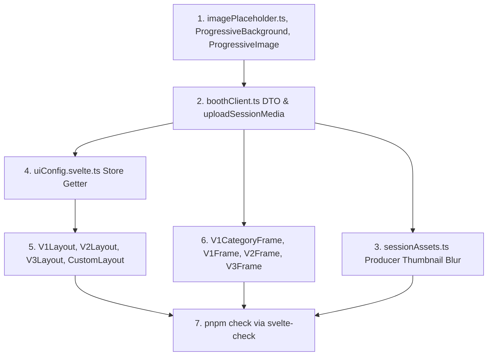

# Plan Komprehensif: Mekanisme Placeholder Blur (24x24) & Progressive Loading

Target repo: **dekstop-app** (Svelte 5, SvelteKit, Vite, Tauri v2)

---

## 1. Latar Belakang & Analisis Aset Desktop App

Sesuai laporan arsitektur:
- `dekstop-app/instructions-reports/ASSET_PROTOCOL_CONVERT_FILE_SRC_REPORT.md`
- `dekstop-app/instructions-reports/ASSET_SYNC_AND_OFFLINE_CACHE_REPORT.md`

Aplikasi desktop telah memiliki sistem offline-first menggunakan **Tauri Asset Protocol (`convertFileSrc`)**. Ketika booth sudah ter-sync, aset dibaca dari filesystem lokal (`asset://` atau `http://asset.localhost/...`) dalam waktu <5ms.

### Peran Blur Placeholder (24×24 px) di Desktop App:
1. **Producer Thumbnail Galeri (`sessionAssets.ts`)**:
   - Saat sesi foto selesai, desktop app mengunggah `photos[0]` dengan tipe `thumbnail`.
   - **Perbaikan**: Sebelum upload, desktop app men-generate `blur_base64` (24×24 px) dari `photos[0]` via Canvas di webview, lalu mengirimkannya ke `uploadSessionMedia`. Ini memberi `GalleryPage` di dashboard placeholder instan saat admin membuka galeri transaksi booth tersebut.
2. **Consumer Background Booth (`ProgressiveBackground.svelte`)**:
   - Menangani transisi visual yang halus antar-langkah (fade-in) dan memberikan tampilan instan saat first boot sebelum prefetch selesai 100%.
3. **Consumer Frame & Category Preview (`ProgressiveImage.svelte`)**:
   - Menampilkan placeholder blur untuk kartu kategori (`V1CategoryFrame.svelte`) dan thumbnail template (`V1Frame.svelte`, `V2Frame.svelte`, `V3Frame.svelte`) saat memuat daftar template dari API/cache.

---

## 2. Daftar File yang Akan Diubah / Ditambah

1. **`dekstop-app/src/lib/utils/imagePlaceholder.ts`** (File Baru)
   - Helper `generateBlurPlaceholder(source: File | Blob | string, size = 24, quality = 0.25): Promise<string>` menggunakan Canvas offscreen di Webview.

2. **`dekstop-app/src/lib/components/shared/ProgressiveBackground.svelte`** (File Baru)
   - Komponen wrapper background layar booth yang mendukung URL protokol lokal (`convertFileSrc`), remote HTTP(S), dan `bg_blur`.

3. **`dekstop-app/src/lib/components/shared/ProgressiveImage.svelte`** (File Baru)
   - Komponen image thumbnail untuk preview frame dan banner kategori di booth client.

4. **`dekstop-app/src/lib/api/boothClient.ts`** (Modifikasi)
   - Memperbarui fungsi `uploadSessionMedia` agar menerima parameter opsional `blurBase64?: string` dan menyertakannya di payload `POST /api/booths/{boothId}/gallery/upload`.
   - Memperbarui interface DTO respons untuk `categories` (`banner_blur`), `templates` (`preview_blur`), dan `banners` (`image_blur`).

5. **`dekstop-app/src/lib/utils/sessionAssets.ts`** (Modifikasi)
   - Pada blok upload `thumbnail` (line 63–78): generate `blur_base64` dari `photos[0]` via `generateBlurPlaceholder(photos[0], 24, 0.25)` sebelum mendaftarkan metadata media.

6. **`dekstop-app/src/lib/stores/uiConfig.svelte.ts`** (Modifikasi)
   - Memperbarui interface `BoothUIStepStyle` dengan `bg_blur?: string | null`.
   - Menambahkan method `getStepBlur(step: string): string | null`.

7. **Layout Booth V1, V2, V3, & Custom** ([dekstop-app/src/lib/components/](file:///home/dwiwahyu/Projects/PotoHub/source-code/dekstop-app/src/lib/components)) (Modifikasi)
   - `V1Layout.svelte`, `V2Layout.svelte`, `V3Layout.svelte`, dan `CustomLayout.svelte`: Membungkus tampilan dengan `ProgressiveBackground`.

8. **Layar Pemilihan Frame & Kategori Booth** (Modifikasi)
   - `dekstop-app/src/lib/components/v1/V1CategoryFrame.svelte` (banner kategori).
   - `dekstop-app/src/lib/components/v1/V1Frame.svelte`, `V2Frame.svelte`, `V3Frame.svelte` (thumbnail template frame).
   - Menggunakan `<ProgressiveImage>` untuk transisi visual thumbnail yang mulus.

---

## 3. Urutan Eksekusi Antar-File (Dependency Order)

1. **Langkah 1**: Buat helper `imagePlaceholder.ts` dan komponen `ProgressiveBackground.svelte` serta `ProgressiveImage.svelte`.
2. **Langkah 2**: Perbarui `boothClient.ts` untuk payload `blurBase64`.
3. **Langkah 3**: Modifikasi `sessionAssets.ts` untuk menghasilkan blur 24×24 pada upload thumbnail slot pertama.
4. **Langkah 4**: Perbarui store `uiConfig.svelte.ts`.
5. **Langkah 5–6**: Integrasikan komponen ke layout booth dan layar pemilihan frame.
6. **Langkah 7**: Jalankan `pnpm check` (`svelte-kit sync && svelte-check`) untuk memvalidasi tipe TypeScript.

---

## 4. Titik Keputusan & Fallback Rules

1. **Prioritas Local Cache (`convertFileSrc`)**:
   - Jika aset sudah di-resolve ke file lokal oleh sistem cache (`resolvedBackgrounds[url]`), `ProgressiveBackground` langsung merender instan tanpa jeda blur.
2. **Resolusi 24×24**:
   - Thumbnail sesi menghasilkan Data URL ~800–1.200 byte yang dikirim via JSON IPC tanpa membebani memori WebView.
3. **Fallback Data Lama**:
   - Jika booth menerima template atau kategori lama dari backend tanpa data blur, `ProgressiveImage` langsung menampilkan placeholder ikon default atau memuat gambar asli secara transparan.
